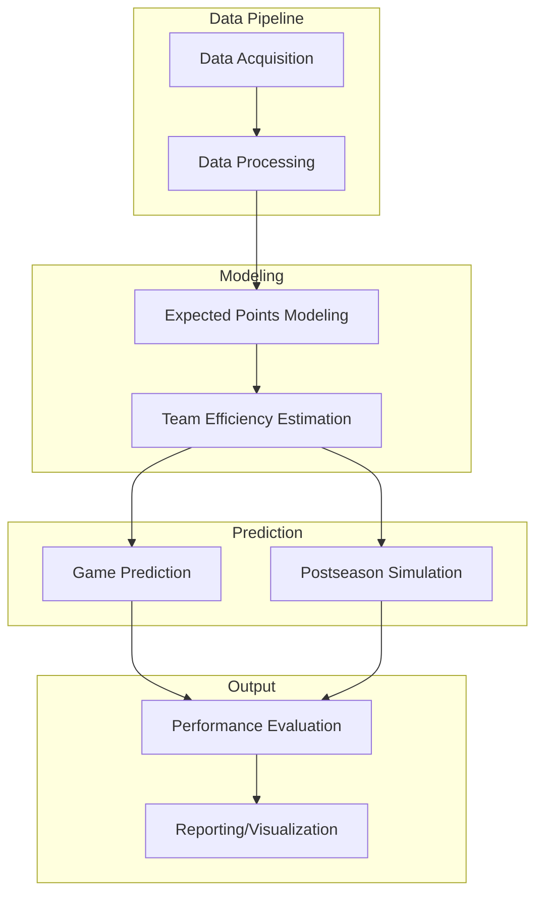

# College Football Models

A comprehensive pipeline for college football data analysis and modeling using R and the `targets` package, powered by the `cfbfastR` package.

## Project Overview

This project implements a data pipeline and modeling framework for analyzing college football performance, predicting game outcomes, and simulating postseason scenarios. It focuses on advanced statistical methods to evaluate team efficiency, expected points, and game predictions.

## Main Components

### 1. Data Acquisition and Processing
- Retrieves college football data using the `cfbfastR` package
- Processes play-by-play data, game information, and team statistics
- Handles data cleaning, transformation, and feature engineering
- Manages team divisions (FBS/FCS) and conference information

### 2. Expected Points Modeling
- Implements an expected points model based on play-by-play data
- Calculates the value of each play in terms of expected points added (EPA)
- Uses multinomial logistic regression to predict the probability of next scoring events
- Evaluates plays, drives, and games using expected points metrics

### 3. Team Efficiency Estimation
- Estimates team efficiency metrics for offense, defense, and special teams
- Adjusts for opponent strength and other contextual factors
- Tracks efficiency metrics over time (by week, season)
- Compares team performance across different play types (pass/rush)

### 4. Game Prediction Modeling
- Develops Bayesian models to predict game outcomes
- Simulates game results with uncertainty quantification
- Evaluates prediction accuracy against actual outcomes
- Compares predictions with betting markets

### 5. Postseason Simulation
- Simulates playoff scenarios based on team efficiency metrics
- Calculates win probabilities for different matchups
- Evaluates championship paths for teams
- Visualizes playoff brackets and outcomes

### 6. Reporting and Visualization
- Generates interactive reports using Quarto
- Creates custom visualizations for team performance
- Produces season reports and team-specific analyses
- Visualizes efficiency metrics and predictions

## Project Structure Diagram

## Key Components and Their Relationships

1. **Data Flow**: The pipeline begins with data acquisition from cfbfastR, which is then processed and transformed for modeling.

2. **Expected Points Model**: The foundation of the analysis is the expected points model, which assigns value to plays based on their impact on scoring probability.

3. **Efficiency Metrics**: Team performance is measured through efficiency metrics derived from the expected points model, adjusted for opponent strength.

4. **Prediction System**: Game outcomes are predicted using Bayesian models that incorporate team efficiency metrics.

5. **Simulation Framework**: Postseason scenarios are simulated using the prediction models to evaluate championship probabilities.

6. **Reporting System**: Results are presented through interactive reports and visualizations using Quarto.

## Implementation Details

The project is implemented as an R pipeline using the `targets` package, which manages dependencies and ensures reproducibility. Key R packages used include:

- `cfbfastR`: For retrieving college football data
- `tidymodels`: For statistical modeling and machine learning
- `rstanarm`: For Bayesian modeling
- `quarto`: For report generation
- `gt` and `ggplot2`: For visualization

While the codebase includes ELO rating functions, the current implementation primarily uses efficiency-based metrics and Bayesian models for predictions rather than ELO ratings.
